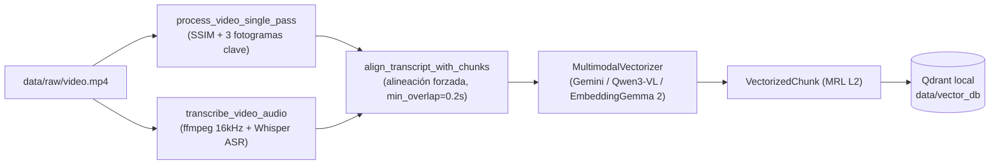
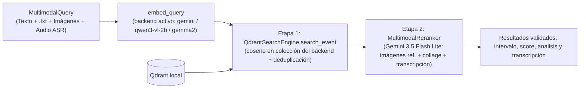

# TFM: Sistema de Recuperación de Información en Vídeo mediante Arquitecturas de Vectorización Multimodal

## Descripción del Proyecto
Este Trabajo de Fin de Máster aborda el ciclo de vida completo para el diseño, desarrollo y validación técnica de un sistema avanzado de recuperación de información multimedia. El propósito del proyecto es implementar una arquitectura capaz de procesar grandes volúmenes de datos no estructurados (vídeo, audio y texto) transformándolos en representaciones vectoriales densas (embeddings) dentro de un espacio semántico unificado.

El sistema resultante permite realizar búsquedas semánticas cruzadas y multimodales (localizar el instante exacto de un evento en un archivo de vídeo a partir de texto libre, archivos `.txt`, imágenes de referencia y/o pistas de audio) sin requerir metadatos manuales previos.

## Objetivo General
Diseñar, implementar y validar empíricamente un sistema avanzado de recuperación de información multimedia basado en arquitecturas de vectorización multimodal, capaz de localizar eventos de interés en grandes volúmenes de datos no estructurados a partir de búsquedas semánticas en lenguaje natural.

## Objetivos Específicos
* **Analizar el estado del arte** tecnológico en el ámbito de los modelos fundacionales multimodales (generación de embeddings) y los sistemas de búsqueda semántica (RAG y bases de datos vectoriales), evaluando las alternativas óptimas para el proyecto.
* **Diseñar la arquitectura técnica** y el flujo de procesamiento (pipeline) de datos, definiendo los métodos para la ingestión, fragmentación, preprocesamiento y vectorización de los archivos de vídeo, audio y texto.
* **Desarrollar una Prueba de Concepto (PoC)** funcional que integre el modelo de embeddings seleccionado, mapeando los distintos tipos de datos en un espacio semántico unificado para permitir búsquedas cruzadas eficientes sin depender de metadatos previos.
* **Evaluar y validar el rendimiento** del sistema mediante la ejecución de un plan de pruebas empíricas, midiendo métricas clave como la precisión en la recuperación de eventos, el coste computacional y la viabilidad técnica general de la solución.
* **Documentar el ciclo de vida completo** del proyecto de ingeniería del software y datos, detallando el marco metodológico utilizado desde la definición de requisitos hasta la validación final.

---

# Documentación técnica del sistema

## 1. ¿Cómo funciona?

El sistema segmenta cada vídeo en **planos visuales (`VideoChunk`)**, extrae y transcribe la **pista completa de audio** con Whisper, alinea temporalmente las locuciones con cada plano y fusiona **imagen + voz transcrita en un único embedding multimodal** almacenado en Qdrant. Soporta tres motores intercambiables (`gemini`, `qwen3-vl-2b` y `gemma2`) con recorte Matryoshka (MRL) y normalización $L_2$. En tiempo de consulta, acepta cualquier combinación de **texto libre, archivos `.txt`, imágenes de referencia y pistas de audio** (`MultimodalQuery`), empaquetándolos en una sola vectorización (Etapa 1) seguida de verificación y reordenación bimodal (visual + auditiva) con Gemini 3.5 Flash Lite (Etapa 2).

### Flujo de indexación



### Flujo de búsqueda en dos etapas



### Integración del vídeo y el audio en cada etapa de búsqueda

| Aspecto | Etapa 1: Búsqueda Vectorial (Qdrant) | Etapa 2: Reordenación Multimodal (`rerank=True`) |
|---|---|---|
| **Modelo** | `gemini-embedding-2-preview` (`gemini`), `Qwen/Qwen3-VL-Embedding-2B` (`qwen3-vl-2b`) o `google/embeddinggemma-2` (`gemma2`) | `gemini-3.5-flash-lite` |
| **Tipo de fusión** | **Fusión Temprana (*Early Fusion*)** en un único vector MRL normalizado en norma $L_2$ | **Evaluación Bimodal Explícita** en un único prompt generativo por lotes |
| **Entrada de vídeo** | 3 fotogramas clave (`inicio`, `mitad de máxima entropía`, `final`) redimensionados a `target_width` (por defecto 512 px) | Collage vertical JPEG (`_build_vertical_collage`) que apila los 3 fotogramas distintos en una sola imagen de 384 px de ancho |
| **Entrada de audio** | Texto transcrito por Whisper y alineado al plano | Texto transcrito recuperado del payload de Qdrant e inyectado junto al collage (`Transcripción hablada en este segmento: "..."`) |
| **Papel en la búsqueda** | Recupera los `top_k * 2` candidatos más cercanos por similitud coseno dentro de la colección del `(backend, dimensión)` activo | Inspecciona conjuntamente imagen y locución, **descarta falsos positivos (`is_relevant=false`)** y reordena los `top_k` mejores por `relevance_score` (`0.0 - 1.0`) |

## 2. Tecnologías utilizadas

| Ámbito | Tecnología |
|---|---|
| Lenguaje | Python 3.13 |
| Procesamiento de vídeo | `opencv-python-headless` (lectura en pasada única, SSIM, entropía de Shannon), `numpy` |
| Procesamiento de audio (ASR) | `openai-whisper` (transcripción con marcas temporales) y `ffmpeg` (`imageio-ffmpeg`) |
| Embeddings multimodales | Google Gemini Embedding 2 (`google-genai`), `Qwen/Qwen3-VL-Embedding-2B` y `google/embeddinggemma-2` (`sentence-transformers`, `transformers`, `torch` en `bfloat16`/`MPS` o `float32`/`CPU`) |
| Verificación bimodal (Etapa 2) | Google Gemini 3.5 Flash Lite (`gemini-3.5-flash-lite`) |
| Base de datos vectorial | Qdrant (`qdrant-client`, modo local embebido) |
| Interfaz de usuario | Streamlit (`app.py`, `src/ui/app.py`) |
| Configuración y concurrencia | `python-dotenv` (`.env` con `GEMINI_API_KEY`), `asyncio` (`Semaphore`, `gather`, `to_thread`) |
| Calidad | `pytest`, `mypy`, `ruff` |

## 3. Estructura del proyecto

```
.
├── app.py                   # Punto de entrada para Streamlit (streamlit run app.py)
├── data/
│   ├── raw/                 # Vídeos de entrada (no versionados)
│   ├── processed/           # Caché de fotogramas clave JPEG por vídeo/chunk
│   ├── vector_db/           # Base de datos Qdrant persistente (modo local)
│   ├── dataframe_gt/        # Dataset ground truth (video_chunks_ground_truth.csv)
│   └── e2e_results/         # Informes y métricas de las baterías E2E
├── audit/                   # Trazabilidad por ejecución (ignorado por git)
├── docs/                    # Memoria LaTeX del TFM
├── src/
│   ├── config.py            # Configuración centralizada, rutas y dataclasses de parámetros
│   ├── models.py            # Modelos de dominio inmutables y excepciones
│   ├── main.py              # Orquestador CLI (indexación, búsqueda interactiva y benchmark)
│   ├── processing/
│   │   ├── video_chunker.py     # Segmentación en pasada única (SSIM) y fotogramas clave
│   │   ├── audio_transcriber.py # Extracción WAV (ffmpeg), transcripción Whisper y alineación forzada
│   │   ├── keyframe_cache.py    # Caché persistente de fotogramas JPEG en data/processed/
│   │   └── pipeline.py          # Orquestación asíncrona vídeo + audio -> VectorizedChunk
│   ├── embeddings/
│   │   ├── base.py              # Protocol MultimodalVectorizer común a cloud y local
│   │   ├── mrl.py               # truncate_and_normalize_mrl (recorte Matryoshka + norma L2)
│   │   ├── gemini_vectorizer.py # Cliente asíncrono de Gemini Embedding 2 (imagen + texto)
│   │   ├── local_vectorizer.py  # Vectorizador local con perfiles Qwen3-VL y EmbeddingGemma 2
│   │   └── factory.py           # Factoría y gestión de un único modelo local en memoria
│   ├── rag_engine/
│   │   ├── service.py       # VideoRAGService (fachada unificada y deduplicación temporal)
│   │   ├── evaluation.py    # Evaluador automatizado (Recall@1, Recall@K, MRR, multi-target y negativas)
│   │   ├── vector_db.py     # QdrantSearchEngine (Etapa 1: Recuperación vectorial)
│   │   └── reranker.py      # MultimodalReranker (Etapa 2: Verificación bimodal con Gemini 3.5 Flash Lite)
│   ├── ui/
│   │   └── app.py           # Interfaz web interactiva con Streamlit
│   └── utils/
│       ├── audit.py         # RunAuditor (logs, config y resultados por run)
│       └── gemini_client.py # Cliente compartido y transporte asíncrono con reintentos
├── tests/                   # Pruebas unitarias (231 tests) y E2E en tests/e2e/
├── requirements.txt
└── AGENTS.md                # Reglas de estilo y desarrollo del repositorio
```

> Regla de arquitectura: nunca se guardan vídeos, datos ni embeddings dentro de `src/`.

## 4. Módulos principales

### 4.1 Fragmentación visual: `src/processing/video_chunker.py`
- **`process_video_single_pass(video_path, threshold=0.5, min_shot_frames=12, resize_width=160, entropy_stride=1, target_width=512, max_shot_duration=8.0)`**: segmenta el vídeo en planos por SSIM y duración máxima (`max_shot_duration`), selecciona 3 fotogramas clave de los tercios interiores por máxima entropía de Shannon y los redimensiona a `target_width` en una sola pasada de OpenCV.
- **`extract_interval_frames`**, **`resize_frame`**, **`encode_frame_jpeg`**, **`compute_ssim`** y **`compute_image_entropy`**.

### 4.2 Transcripción y alineación de audio: `src/processing/audio_transcriber.py`
- **`extract_audio_track(video_path, output_wav=None)`**: extrae la pista de audio completa en un archivo temporal `.wav` (PCM 16-bit, mono `-ac 1`, `16000 Hz`, `-vn`) mediante `ffmpeg` sin `shell=True`. Si el vídeo no contiene pista de audio, limpia el temporal y devuelve `None`.
- **`transcribe_audio(audio_path, model_name="base", language="es", transcriber_fn=None)`**: transcribe el audio completo con `openai-whisper` cacheando el modelo en memoria a nivel de módulo y devuelve una lista ordenada de `TranscriptSegment(start_time, end_time, text)`.
- **`transcribe_video_audio(video_path, model_name="base", language="es")`**: encadena extracción y transcripción garantizando el borrado del `.wav` temporal en un bloque `finally`.
- **`transcribe_query_audios(audio_inputs, model_name="base", language="es")`**: convierte pistas de audio de consulta (archivos `.wav`, `.mp3`, `.m4a`, `.ogg` o `bytes` grabados desde el micrófono) a WAV 16 kHz mono temporal con `ffmpeg`, las transcribe con la caché de Whisper y aplica degradación elegante limpiando siempre los archivos temporales.
- **`align_transcript_with_chunks(chunks, segments, min_overlap=0.2)`**: cruza los segmentos transcritos con los intervalos `[start_time, end_time]` de cada `VideoChunk`. Asigna un segmento si la intersección temporal es `>= min_overlap` o si el segmento está completamente contenido en el plano. Cuando una frase hablada cruza el corte entre dos planos superando `min_overlap` en ambos, se asigna a ambos como solapamiento semántico fronterizo.

### 4.3 Backends de embeddings y MRL: `src/embeddings/`
Todos los motores implementan el protocolo `MultimodalVectorizer` (`base.py`) y normalizan su salida truncada con `truncate_and_normalize_mrl` (`mrl.py`):

| Backend (`--embedding-backend`) | Checkpoint / Modelo | Ubicación | Dimensiones MRL válidas (por defecto primera) | Colección Qdrant |
|---|---|---|---|---|
| `gemini` (por defecto) | `gemini-embedding-2-preview` | `Cloud API` | **`3072`**, `1536`, `768` | `video_chunks` (en 3072) / `video_chunks__gemini__<dim>` |
| `qwen3-vl-2b` | `Qwen/Qwen3-VL-Embedding-2B` | `Local MPS` / `Local CPU` | **`2048`**, `1536`, `768` | `video_chunks__qwen3-vl-2b__<dim>` |
| `gemma2` | `google/embeddinggemma-2` | `Local MPS` / `Local CPU` | **`768`**, `512`, `256` | `video_chunks__gemma2__<dim>` |

- **`GeminiMultimodalVectorizer` (`gemini_vectorizer.py`)**: codifica los 3 fotogramas clave a JPEG y adjunta la transcripción en un único `types.Content` hacia `gemini-embedding-2-preview` (1 petición por chunk o consulta multimodal).
- **`LocalMultimodalVectorizer` (`local_vectorizer.py`)**: carga `sentence-transformers` de forma perezosa y adapta el formato multimodal por perfil (diccionario con imágenes PIL RGB y prompts de documento/consulta en Qwen3-VL; marcas `<|image|>` y prefijos `Document`/`SearchQuery` en EmbeddingGemma 2). Serializa llamadas bajo un `threading.Lock` y rechaza valores `NaN` o infinitos con `VectorizationError`.
- **Regla de dtype y aviso crítico de `float16`**: los modelos locales usan estrictamente `torch.bfloat16` cuando `mps` está disponible y `torch.float32` en `cpu` (no existe parámetro para usar `float16`, porque **EmbeddingGemma 2 produce valores `NaN` silenciosos en `float16`**).
- **Gestión de memoria (`factory.py`)**: `create_vectorizer` y `unload_active_vectorizer` mantienen como máximo **un modelo local residente en memoria** a la vez; al cambiar de modelo o pasar a `gemini`, se libera la referencia y se ejecuta `gc.collect()` junto con `torch.mps.empty_cache()`.
- **Descarga inicial de pesos locales**: la primera ejecución con `qwen3-vl-2b` y `gemma2` descarga en conjunto **unos 6 GB** de pesos en `~/.cache/huggingface` (~4 GB Qwen3-VL 2B y ~2 GB EmbeddingGemma 2).

### 4.4 Pipeline de ingestión: `src/processing/pipeline.py`
`process_video_pipeline(..., output_dimensionality=3072, embedding_backend="gemini")`:
1. Ejecuta `process_video_single_pass` y verifica el cortafuegos `MAX_CHUNKS_PER_VIDEO = 800` (`QuotaSafetyError`) exclusivamente en backends en la nube (`gemini`).
2. Si `enable_audio=True`, ejecuta `transcribe_video_audio` y `align_transcript_with_chunks`. Ante cualquier fallo de `ffmpeg` o del modelo local, registra un `WARNING` y continúa con la modalidad visual (**degradación elegante**).
3. Guarda en caché los fotogramas clave (`data/processed/`). Si el backend es local, ejecuta `unload_whisper_models()` antes de cargar el modelo de embeddings y fuerza concurrencia `1` para proteger la memoria unificada.

### 4.5 Base de datos vectorial y fachada de servicio: `src/rag_engine/vector_db.py` y `src/rag_engine/service.py`
- **`QdrantSearchEngine`**: persiste en `./data/vector_db` con métrica coseno e IDs deterministas (`uuid5`) sobre la colección activa (`use_collection`). Conserva `video_chunks` exclusivamente para `gemini` en `3072` dimensiones y utiliza el prefijo `video_chunks__<backend>__<dim>` para el resto de combinaciones. Si una colección ya existe con una dimensión distinta y `recreate=False`, `create_collection` lanza `VectorDBError` sin borrar los vectores existentes.
- **`VideoRAGService`**: gestiona `(embedding_backend, vector_size)` con `set_embedding`, coordina la indexación registrando `last_index_stats` (`IndexStats`), cachea embeddings de consulta por `(backend, dimensión, modalidades)` y aplica deduplicación temporal (`_deduplicate_temporal_candidates`) antes de enviar candidatos al reranker VLM.

### 4.6 Reordenación y Verificación Bimodal (Etapa 2): `src/rag_engine/reranker.py`
- **`MultimodalReranker`**: combina los fotogramas cacheados de cada candidato en un collage vertical y adjunta su `transcript` alineado (además de las imágenes de referencia `query_images` de la consulta cuando el usuario las aporta) en una única llamada por lotes a `gemini-3.5-flash-lite`.
- **Evaluación bimodal (Visual + Auditiva)**: valida un fragmento (`is_relevant: true`) si el concepto o imagen de referencia buscada aparece en los fotogramas, si se explica en la locución transcrita o en ambos, devolviendo `RerankedResult(result, relevance_score, is_relevant, reasoning)`. Si la API falla tras los reintentos, conserva el orden vectorial de la Etapa 1.

## 5. Instalación

```bash
# 1. Entorno virtual
python -m venv env_tfm
source env_tfm/bin/activate

# 2. Dependencias (incluye openai-whisper e imageio-ffmpeg)
pip install -r requirements.txt

# 3. Clave de API
echo "GEMINI_API_KEY=tu_clave" > .env
```

Coloca los vídeos a procesar en `data/raw/`.

## 6. Uso y parámetros de ejecución

### 6.1 Interfaz Web Interactiva (Streamlit UI)

```bash
streamlit run app.py
```

#### Características de la UI:
- **Selector de motor de embeddings**: en la barra lateral (**Motor de Embeddings**), permite alternar entre `Cloud: Gemini`, `Local: Qwen3-VL 2B` y `Local: EmbeddingGemma 2`, ajustando dinámicamente las dimensiones MRL válidas, la colección activa de Qdrant, el dispositivo (`Cloud API`, `Local MPS` o `Local CPU`) y el tiempo de indexación (`chunks`, segundos y `s/chunk`).
- **Gestión e indexación de vídeos**: subida de archivos (`.mp4`, `.avi`, `.mov`, `.mkv`), indexación de vídeos locales en `data/raw/`, re-indexación y borrado selectivo o completo de la base de datos.
- **Consultas multimodales con dos botones desplegables junto al buscador**:
  - **`Audio`**: permite grabar voz directamente desde el micrófono (`st.audio_input`) y/o subir una o varias pistas de audio (`.wav`, `.mp3`, `.m4a`, `.ogg`).
  - **`Imágenes / .txt`**: permite subir una o varias imágenes de referencia (`.png`, `.jpg`, `.jpeg`, `.webp`) y archivos `.txt`.
  - Permite ejecutar la búsqueda aunque el cuadro de texto esté vacío siempre que exista al menos un adjunto activo, mostrando debajo del buscador un resumen visual compacto (miniaturas de imágenes, reproductor de audio y transcripción detectada por Whisper).
- **Parámetros de indexación ajustables**: controles para SSIM (`threshold`, `min_shot_frames`, `entropy_stride`), red (`max_concurrent`, `jpeg_quality`, `target_width`) y **transcripción ASR con Whisper** (activación de audio y selector de modelo `tiny`, `base`, `small`).
- **Tarjetas de resultados bimodales**: muestran el intervalo temporal, insignia de validación VLM, barra de relevancia, explicación bimodal, transcripción hablada del segmento y botón **"Saltar aquí"** sincronizado con el reproductor de vídeo.

#### Parámetros óptimos de indexación en la UI por tipo de vídeo:

| Bloque | Control en la interfaz | `python_tutorial.mp4` (Screencast / Código) | `animals.mp4` (Naturaleza / Documental) |
|---|---|:-:|:-:|
| **Fragmentación SSIM** | **Umbral SSIM** | **`0.60`** | **`0.50`** |
| **Fragmentación SSIM** | **Fotogramas mínimos por plano** | **`12`** | **`12`** |
| **Fragmentación SSIM** | **Paso de muestreo de entropía** | **`1`** | **`1`** |
| **Vectorización y Red** | **Concurrencia máxima API** | **`3`** | **`3`** |
| **Vectorización y Red** | **Calidad JPEG fotogramas** | **`80` - `85`** | **`80`** |
| **Vectorización y Red** | **Ancho máx. fotogramas (px)** | **`512`** | **`512`** |
| **Transcripción de Audio (ASR)** | **Transcribir y alinear audio (Whisper)** | **Activado (`True`)** | **Activado (`True`)** |
| **Transcripción de Audio (ASR)** | **Modelo Whisper** | **`base`** | **`base`** |

### 6.2 Línea de Comandos (CLI)

```bash
# Indexar un vídeo con Gemini (por defecto) y buscar
python -m src.main --index --video python_tutorial.mp4

# Indexar y buscar en local con Qwen3-VL 2B o EmbeddingGemma 2 (sin rerank = sin cuota cloud)
python -m src.main --index --video python_tutorial.mp4 --embedding-backend qwen3-vl-2b
python -m src.main --index --video python_tutorial.mp4 --embedding-backend gemma2 --no-rerank

# Indexar con otro modelo de Whisper o desactivando el audio
python -m src.main --index --video python_tutorial.mp4 --whisper-model small
python -m src.main --index --video animals.mp4 --no-audio

# Buscar sobre la colección del backend/dimensión elegidos (bucle interactivo)
python -m src.main --embedding-backend gemma2 --no-rerank

# Búsqueda multimodal directa (one-shot) combinando texto, .txt, imágenes y/o audios
python -m src.main --query "camaleón" --query-txt nota.txt --query-images ref.jpg --query-audios voz.wav
```

| Argumento | Por defecto | Descripción |
|---|---|---|
| `--index` | desactivado | Fragmenta, transcribe, vectoriza e indexa el vídeo antes de buscar |
| `--video` | `test_video.mp4` | Nombre del vídeo dentro de `data/raw/` |
| `--embedding-backend` | `gemini` | Motor de embeddings: `gemini`, `qwen3-vl-2b` o `gemma2` |
| `--output-dimensionality` | nativa del backend | Dimensión Matryoshka validada por backend (`gemini`: 3072/1536/768; `qwen3-vl-2b`: 2048/1536/768; `gemma2`: 768/512/256) |
| `--top-k` | `5` | Número de resultados devueltos por búsqueda |
| `--max-concurrent` | `3` | Peticiones simultáneas a Gemini (los backends locales fuerzan `1` y emiten aviso si se indica `> 1`) |
| `--threshold` | `0.5` | Umbral SSIM para detección de cortes de plano |
| `--min-shot-frames` | `12` | Mínimo de fotogramas por plano |
| `--entropy-stride` | `1` | Paso de muestreo para cálculo de entropía |
| `--jpeg-quality` | `80` | Calidad JPEG enviada a Gemini (1-100) |
| `--target-width` | `512` | Ancho máximo de redimensionado de fotogramas (px) |
| `--rerank` / `--no-rerank` | `True` | Activa o desactiva la Etapa 2 con Gemini 3.5 Flash Lite |
| `--no-audio` | `False` | Desactiva la extracción y transcripción de audio con Whisper |
| `--whisper-model` | `base` | Modelo local de OpenAI Whisper (`tiny`, `base`, `small`, etc.) |
| `--benchmark` | `None` | Ruta a archivo JSON con consultas ground truth para evaluación automática |
| `--query` | `None` | Texto directo para ejecutar una búsqueda one-shot sin bucle interactivo |
| `--query-txt` | `None` | Uno o varios archivos `.txt` cuyo contenido se une a la consulta |
| `--query-images` | `None` | Una o varias imágenes de referencia (`.jpg`, `.jpeg`, `.png`, `.webp`) |
| `--query-audios` | `None` | Una o varias pistas de audio de consulta (`.wav`, `.mp3`, `.m4a`, `.ogg`) |

Ejemplo de salida en CLI con transcripción y reranker bimodal:

```
Introduce tu búsqueda: Diccionarios

Top 5 resultados:
  1. [python_tutorial.mp4] 01:25.1 - 01:33.1  (85.1s - 93.1s)
      Relevancia VLM: 1.00 (VALIDADO) | Coseno Qdrant: 0.4480
      Análisis visual: Explica y muestra visualmente los diccionarios en Python.
      Transcripción: "Y ya por último, los diccionarios. Que utilizan la palabra reservada, dict. Y en realidad, designa un conjunto de cla..."
  2. [python_tutorial.mp4] 01:33.1 - 01:40.2  (93.1s - 100.2s)
      Relevancia VLM: 0.90 (VALIDADO) | Coseno Qdrant: 0.4178
      Análisis visual: Continúa explicando la sintaxis y representación de los diccionarios.
      Transcripción: "Lo representamos entre llaves, pero esta clave valor separadas por dos puntos. Y cada uno de los elementos por comas...."
```

### 6.3 Parámetros internos por defecto (`src/config.py`)

| Parámetro | Valor | Configuración | Descripción |
|---|---|---|---|
| `max_shot_duration` | `8.0 s` | `ChunkingConfig` | Duración máxima de un plano antes de forzar una subdivisión temporal |
| `resize_width` | `160 px` | `ChunkingConfig` | Ancho de reducción para el cálculo de SSIM en escala de grises |
| `output_dimensionality` / `VECTOR_SIZE` | `3072` | `VectorizerConfig` | Dimensión del vector denso de `gemini-embedding-2-preview` |
| `max_retries` / `retry_base_delay` | `4` / `4.0 s` | `VectorizerConfig` | Backoff exponencial (4s, 8s, 16s, 32s) ante errores 429 o 503 |
| `enable_audio` / `whisper_model` / `language` | `True` / `"base"` / `"es"` | `AudioConfig` | Parámetros por defecto de transcripción ASR y alineación temporal |
| `MAX_CHUNKS_PER_VIDEO` | `800` | `src/config.py` | Cortafuegos que aborta antes de gastar cuota si se superan 800 chunks |

## 7. Límites de la API (capa gratuita de Google AI Studio)

| Límite | Valor | Mecanismo de protección |
|---|---|---|
| RPD (peticiones/día) | 1.000 | `MAX_CHUNKS_PER_VIDEO = 800` + fusión temprana de imagen y audio en 1 vector/chunk |
| RPM (peticiones/minuto) | 100 | Concurrencia limitada a 3 con `asyncio.Semaphore` |
| TPM (tokens/minuto) | 30.000 | Fotogramas a 512px (~700 tokens visuales + ~40 tokens de transcripción por chunk) y backoff exponencial |

## 8. Trazabilidad y auditoría

Cada sesión en CLI (`src/main.py`) o Streamlit (`src/ui/app.py`) crea una carpeta `audit/run_YYYYMMDD_HHMMSS/` con:

| Fichero | Contenido |
|---|---|
| `execution.log` | Logs completos a nivel `DEBUG` (segmentación, alineación de audio, llamadas HTTP, Qdrant y reranker) |
| `run_config.json` | Parámetros de ejecución (`embedding_backend`, `embedding_dimension`, `device`, `index_seconds`, `chunking_defaults`, `vectorizer_defaults`, `search_defaults`, `audio_defaults`, `cli_args`) |
| `search_results.json` | Historial de búsquedas de la sesión incluyendo `modalities` (`modality_summary`), `score`, `relevance_score`, `is_relevant`, `reasoning` y `transcript` |

## 9. Resultados empíricos con fusión audiovisual

### 9.1 Resolución de consultas conceptuales en `python_tutorial.mp4`
- **Ingestión multimodal (`threshold=0.5, max_shot_duration=8.0s` / `threshold=0.6, max_shot_duration=5.0s`)**: el 98,3% - 98,8% de los fragmentos quedan enriquecidos con transcripción alineada en ~11,0 s con Whisper `base`.
- **Consulta `"Diccionarios"`**: el intervalo `01:25.1 - 01:33.1` sube a `score = 0.4480` (Top-1, `relevance_score = 1.00`) y el segmento contiguo `01:33.1 - 01:40.2` (que sin audio era descartado con `0.0` por aparición del rótulo `"Variables"`) asciende al Top-2 con `score = 0.4178` y `relevance_score = 0.90`.
- **Consulta `"Bucles while"`**: el fragmento explicativo (`03:52.4 - 03:58.3`) pasa de la posición #7 (`0.3893` solo visual) al **Top-1 directo en Qdrant (`0.4957`)** con `relevance_score = 1.00`, mientras que el reranker bimodal descarta con `0.0` los planos que explican bucles `for`.

### 9.2 Batería completa de pruebas E2E (`data/e2e_results/`)
Comparativa entre la línea base visual (`2026-11-06`, [`informe_pruebas_e2e.md`](data/e2e_results/informe_pruebas_e2e.md)) y el pipeline multimodal con audio Whisper (`2026-11-09`, [`informe_pruebas_e2e_audio_20261109.md`](data/e2e_results/informe_pruebas_e2e_audio_20261109.md)):

| Vídeo | Etapa / Batería | Métrica | Visual (`2026-11-06`) | Visual + Audio (`2026-11-09`) | Variación |
|---|---|---|:-:|:-:|:-:|
| `python_tutorial.mp4` (56 consultas) | Etapa 1 (Retrieval) | **Recall@1** | 67,9 % (38/56) | **85,7 % (48/56)** | **+17,8 pp** |
| `python_tutorial.mp4` (56 consultas) | Etapa 1 (Retrieval) | **Recall@5 / MRR** | 91,1 % / 0,779 | **94,6 % / 0,897** | **+3,5 pp / +0,118** |
| `python_tutorial.mp4` (56 consultas) | Etapa 2 (Juez Bimodal) | **Recall@1** | 80,4 % (45/56) | **89,3 % (50/56)** | **+8,9 pp** |
| `python_tutorial.mp4` (56 consultas) | Etapa 2 (Juez Bimodal) | **Recall@5 / MRR** | 89,3 % / 0,848 | **92,9 % / 0,911** | **+3,6 pp / +0,063** |
| `python_tutorial.mp4` (10 multi-objetivo) | Etapa 2 (Juez Bimodal) | **Interval Recall medio** | 78,3 % | **82,1 %** | **+3,8 pp** |
| `animals.mp4` (46 consultas) | Etapa 2 (Juez Bimodal) | **Recall@1** | 89,1 % (41/46) | **93,5 % (43/46)** | **+4,4 pp** |
| `animals.mp4` (46 consultas) | Etapa 2 (Juez Bimodal) | **Recall@5 / MRR** | 93,5 % / 0,913 | **97,8 % / 0,951** | **+4,3 pp / +0,038** |
| Ambos vídeos (16 negativas) | Etapa 2 (Juez Bimodal) | **Rechazo de falsos positivos** | 100,0 % (0/80 FP) | **100,0 % (0/80 FP)** | **=** |

### 9.3 Comparativa de backends de embeddings en `python_tutorial.mp4` (Etapa 1, sin reranker)
Resultados medidos en Apple Silicon (`Local MPS` con `bfloat16`, `target_width=512`, 82 chunks y 56 consultas de [`video_chunks_ground_truth.csv`](data/dataframe_gt/video_chunks_ground_truth.csv), fuente: [`embedding_backends_20261113.csv`](data/e2e_results/embedding_backends_20261113.csv)):

| Backend | Dim | Dispositivo | Index (s) | s/chunk | Recall@1 | Recall@5 | MRR | Query mediana (ms) | Pico RSS (MB) | Pico MPS (MB) |
|---|---|---|:-:|:-:|:-:|:-:|:-:|:-:|:-:|:-:|
| `gemini` | 3072 | `Cloud API` | - (reutilizado) | - | 0,8571 | 0,9464 | 0,8973 | 419,83 | 383,0 | - |
| `qwen3-vl-2b` | 2048 | `Local MPS` | 160,99 | 1,963 | 0,7500 | 0,9464 | 0,8289 | 142,78 | 2509,4 | 4736,5 |
| `gemma2` | 768 | `Local MPS` | 272,99 | 3,329 | 0,7679 | 0,9643 | 0,8512 | 33,07 | 3070,0 | 2552,5 |

## 10. Tests y calidad de código

```bash
python -m pytest                                                                                           # pruebas unitarias (231 tests, sin red ni GPU)
python -m pytest tests/e2e -m e2e -q                                                                       # baterías E2E con la API real de Gemini
python -m pytest tests/e2e/test_local_models_smoke_e2e.py tests/e2e/test_embedding_backends_e2e.py -m e2e_local -v  # humo MPS y benchmark comparativo (escribe CSV en data/e2e_results/)
python -m ruff check src tests                                                                             # linter
python -m mypy --strict --explicit-package-bases src tests                                                 # tipado estático estricto
```

Las 231 pruebas unitarias se ejecutan en ~2,5 segundos simulando `ffmpeg`, Whisper, el cliente de Gemini y `SentenceTransformer`, y utilizando Qdrant en memoria o en directorios temporales. Las pruebas `-m e2e` evalúan las baterías literal (`data/dataframe_gt/video_chunks_ground_truth.csv`), multi-objetivo y negativa sobre `animals.mp4` y `python_tutorial.mp4` con Gemini. Las pruebas `-m e2e_local` validan los pesos reales en `bfloat16` sobre Apple MPS (sin `NaN`, orden de marcas `<|image|>` y consulta de solo imagen en Gemma 2) y generan el informe comparativo en `data/e2e_results/`.
