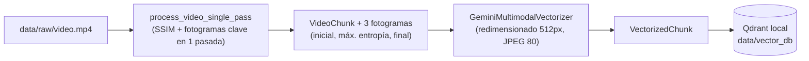
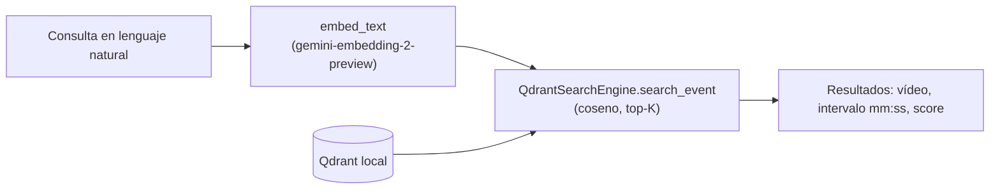

# TFM: Sistema de Recuperación de Información en Vídeo mediante Arquitecturas de Vectorización Multimodal

## Descripción del Proyecto
Este Trabajo de Fin de Máster aborda el ciclo de vida completo para el diseño, desarrollo y validación técnica de un sistema avanzado de recuperación de información multimedia. El propósito del proyecto es implementar una arquitectura capaz de procesar grandes volúmenes de datos no estructurados (vídeo, audio y texto) transformándolos en representaciones vectoriales densas (embeddings) dentro de un espacio semántico unificado. 

El sistema resultante permitirá realizar búsquedas semánticas cruzadas (por ejemplo, localizar el instante exacto de un evento en un archivo de vídeo a partir de una consulta en lenguaje natural) sin requerir metadatos previos.

## Objetivo General
Diseñar, implementar y validar empíricamente un sistema avanzado de recuperación de información multimedia basado en arquitecturas de vectorización multimodal, capaz de localizar eventos de interés en grandes volúmenes de datos no estructurados a partir de búsquedas semánticas en lenguaje natural[cite: 1].

## Objetivos Específicos
* **Analizar el estado del arte** tecnológico en el ámbito de los modelos fundacionales multimodales (generación de embeddings) y los sistemas de búsqueda semántica (RAG y bases de datos vectoriales), evaluando las alternativas óptimas para el proyecto[cite: 1].
* **Diseñar la arquitectura técnica** y el flujo de procesamiento (pipeline) de datos, definiendo los métodos para la ingestión, fragmentación, preprocesamiento y vectorización de los archivos de vídeo, audio y texto[cite: 1].
* **Desarrollar una Prueba de Concepto (PoC)** funcional que integre el modelo de embeddings seleccionado, mapeando los distintos tipos de datos en un espacio semántico unificado para permitir búsquedas cruzadas eficientes sin depender de metadatos previos[cite: 1].
* **Evaluar y validar el rendimiento** del sistema mediante la ejecución de un plan de pruebas empíricas, midiendo métricas clave como la precisión en la recuperación de eventos, el coste computacional y la viabilidad técnica general de la solución[cite: 1].
* **Documentar el ciclo de vida completo** del proyecto de ingeniería del software y datos, detallando el marco metodológico utilizado desde la definición de requisitos hasta la validación final[cite: 1].

---

# Documentación técnica de la PoC

> Estado actual: Prueba de Concepto funcional de extremo a extremo (indexación de un vídeo + búsqueda semántica interactiva por consola). Probada con `data/raw/python_tutorial.mp4` (~4 min).

## 1. ¿Cómo funciona?

El sistema convierte un vídeo en una colección de **fragmentos semánticos (chunks)**, representa cada fragmento con **un único embedding multimodal** y los almacena en una **base de datos vectorial**. Una consulta en lenguaje natural se vectoriza con el mismo modelo y se compara por similitud del coseno, devolviendo los intervalos de tiempo (`start_time` – `end_time`) más relevantes. No se usan metadatos previos del vídeo.

### Flujo de indexación



### Flujo de búsqueda



## 2. Tecnologías utilizadas

| Ámbito | Tecnología |
|---|---|
| Lenguaje | Python 3.13 |
| Procesamiento de vídeo | `opencv-python-headless` (lectura, SSIM, histogramas), `numpy` |
| Embeddings multimodales | Google Gemini Embedding 2 (`gemini-embedding-2-preview`) vía SDK `google-genai` |
| Base de datos vectorial | Qdrant (`qdrant-client`, modo local embebido) |
| Configuración | `python-dotenv` (`.env` con `GEMINI_API_KEY`) |
| Concurrencia | `asyncio` (`Semaphore`, `gather`, `to_thread`) |
| Calidad | `pytest`, `mypy`, `ruff` |
| Exploración | `jupyterlab`, `notebook`, `pandas` |

## 3. Estructura del proyecto

```
.
├── data/
│   ├── raw/                 # Vídeos de entrada (no versionados)
│   ├── processed/           # Caché de fotogramas clave JPEG por vídeo/chunk
│   └── vector_db/           # Base de datos Qdrant persistente (modo local)
├── audit/                   # Trazabilidad por ejecución (ignorado por git)
├── notebooks/               # Pruebas exploratorias de embeddings
├── src/
│   ├── config.py            # Configuración centralizada, rutas y dataclasses de parámetros
│   ├── models.py            # Modelos de dominio inmutables y excepciones
│   ├── main.py              # Orquestador CLI (indexación + búsqueda interactiva)
│   ├── processing/
│   │   ├── video_chunker.py # Detección de planos (SSIM) y fotogramas clave
│   │   ├── keyframe_cache.py # Caché persistente de fotogramas JPEG en data/processed/
│   │   └── pipeline.py      # Orquestación asíncrona vídeo → VectorizedChunk
│   ├── embeddings/
│   │   └── gemini_vectorizer.py  # Cliente asíncrono de Gemini Embedding 2
│   ├── rag_engine/
│   │   ├── service.py       # VideoRAGService (fachada unificada de indexación y búsqueda)
│   │   ├── evaluation.py    # Benchmark automatizado (Recall@1, Recall@K, MRR, latencia)
│   │   ├── vector_db.py     # QdrantSearchEngine (Etapa 1: Recuperación)
│   │   └── reranker.py      # MultimodalReranker (Etapa 2: Verificación VLM con Gemini 3.5 Flash Lite)
│   └── utils/
│       ├── audit.py         # RunAuditor (logs, config y resultados por run)
│       └── gemini_client.py # Cliente compartido y transporte asíncrono con reintentos
├── tests/                   # Pruebas unitarias con pytest
├── requirements.txt
└── .cursorrules             # Reglas de código del proyecto
```

> Regla de arquitectura: nunca se guardan vídeos, datos ni embeddings dentro de `src/`.

## 4. Módulos

### 4.1 Fragmentación: `src/processing/video_chunker.py`
- **`process_video_single_pass(video_path, threshold=0.5, min_shot_frames=12, resize_width=160, entropy_stride=1, target_width=512)`**: **arquitectura de pasada única**. Segmenta el vídeo en planos (SSIM), extrae simultáneamente los 3 fotogramas clave (inicial, mayor entropía visual y final) y los redimensiona a `target_width` en un único recorrido secuencial de OpenCV.
- **`extract_interval_frames(video_path, start_time, end_time, num_frames=2, target_width=512)`**: extrae fotogramas equiespaciados y redimensionados de un intervalo temporal.
- **`resize_frame(frame, target_width)`** y **`encode_frame_jpeg(frame, jpeg_quality=80, target_width=0)`**: redimensionado proporcional y codificación JPEG en memoria compartidos por la vectorización y la reordenación.
- **`compute_ssim(frame_a, frame_b, window_size=7)`**: similitud estructural media entre fotogramas consecutivos en escala de grises.
- **`compute_image_entropy(frame)`**: entropía de Shannon del histograma de grises (`cv2.calcHist`).

### 4.2 Vectorización: `src/embeddings/gemini_vectorizer.py`
- **`GeminiMultimodalVectorizer`**: lee `GEMINI_API_KEY` del entorno (`.env`), redimensiona fotogramas grandes al ancho `target_width` (por defecto 512px), los codifica a JPEG (por defecto calidad 80) y los envía en **un único `Content`** para obtener **un solo vector por chunk**.
- **Optimización de tokens y cuota TPM**: el pre-redimensionado a 512px reduce el payload en un 88% (~16 KB/frame) y el consumo de tokens en un ~60% (~700 tokens/chunk vs ~1.800 tokens a 1080p), evitando exceder el límite gratuito de 30.000 TPM de Google AI Studio.
- **`vectorize_chunk(chunk, key_frames)`** (asíncrono) → `VectorizedChunk(index, start_time, end_time, embedding)`.
- **`embed_text(text)`** (asíncrono): embedding de solo texto para las consultas, en el mismo espacio semántico.
- **Reintentos**: backoff exponencial ante errores transitorios (HTTP 429, 500, 502, 503, 504 y fallos de red). Los errores no recuperables lanzan `VectorizationError`.
- Si la dimensión es inferior a 3072 el vector se normaliza (L2).

### 4.3 Pipeline: `src/processing/pipeline.py`
`process_video_pipeline(video_path, max_concurrent_requests=3, threshold=0.5, min_shot_frames=12, resize_width=160, entropy_stride=1, jpeg_quality=80, output_dimensionality=3072, target_width=512)`:
1. Procesa el vídeo en **pasada única** (`process_video_single_pass` en un hilo para no bloquear el bucle de eventos), obteniendo simultáneamente los cortes de plano y sus 3 fotogramas clave.
2. Vectoriza todos los chunks en paralelo, redimensionando a `target_width`, limitando la concurrencia con `asyncio.Semaphore` y esperando con `asyncio.gather`.
3. Devuelve los `VectorizedChunk` ordenados por índice. Los chunks que fallan de forma definitiva se registran y se omiten.

**Fail-safe de cuota**: si el vídeo genera más de `MAX_CHUNKS_PER_VIDEO = 800` chunks, se aborta con `QuotaSafetyError` **antes** de gastar ninguna petición.

### 4.4 Base de datos vectorial: `src/rag_engine/vector_db.py`
Se utiliza **Qdrant en modo local embebido** (sin servidor ni Docker), persistido en `./data/vector_db`.

| Aspecto | Configuración |
|---|---|
| Colección | `video_chunks` |
| Dimensión | 3072 |
| Métrica | Similitud del coseno (`Distance.COSINE`) |
| ID de punto | UUID determinista (`uuid5` de `"<vídeo>:<índice>"`): reindexar el mismo chunk lo sobrescribe |
| Payload | `video_name`, `chunk_index`, `start_time`, `end_time` |
| Búsqueda | `query_points` (sustituye al antiguo `search`, eliminado en `qdrant-client` recientes) |

`QdrantSearchEngine` expone `create_collection`, `insert_chunks` y `search_event`, que devuelve objetos `SearchResult` (`score`, `video_name`, `chunk_index`, `start_time`, `end_time`).

> El modo local bloquea la carpeta de la base de datos: no abras dos procesos sobre `data/vector_db` a la vez.

### 4.5 Reordenación y Verificación Multimodal (Etapa 2): `src/rag_engine/reranker.py`
Para mitigar la brecha modal (*Cross-Modal Gap*) y descartar falsos positivos semánticos (por ejemplo, fragmentos de glóbulos rojos al buscar *"Reptil"*), se incorpora una **segunda etapa de reordenación**:
- **Arquitectura Bi-Encoder + Cross-Encoder / VLM**:
  - **Etapa 1**: `QdrantSearchEngine` recupera de forma ultrarrápida los $K$ candidatos preliminares mediante similitud coseno con `gemini-embedding-2-preview` (consumo: 1 llamada a embedding).
  - **Etapa 2**: `MultimodalReranker` extrae fotogramas clave de cada candidato y realiza **una única llamada por lotes** a **`gemini-3.5-flash-lite`** (modelo con 500 RPD, 15 RPM y 250K TPM en la capa gratuita).
- **Salida estructurada**: El VLM evalúa los fotogramas, determina `is_relevant: bool`, calibra `relevance_score: float` (0.0 a 1.0) y genera una justificación visual en lenguaje natural (`reasoning`).
- **Modo tolerante a fallos**: Si la API externa experimenta caídas o se agota la cuota, el sistema aplica un *fallback* automático preservando los resultados vectoriales de la Etapa 1.

### 4.6 Auditoría: `src/utils/audit.py`
`RunAuditor` es un gestor de contexto que envuelve toda la ejecución de `main.py` y las sesiones de Streamlit. Ver la sección 8.

## 5. Instalación

```bash
# 1. Entorno virtual
python -m venv env_tfm
source env_tfm/bin/activate

# 2. Dependencias
pip install -r requirements.txt

# 3. Clave de API (nunca se hardcodea; se lee con os.getenv)
echo "GEMINI_API_KEY=tu_clave" > .env
```

Coloca el vídeo a procesar en `data/raw/`.

## 6. Uso y parámetros de ejecución

Existen dos formas de interactuar con el sistema: mediante la **interfaz gráfica interactiva (Streamlit)** o por **consola (CLI)**.

### 6.1 Interfaz Web Interactiva (Streamlit UI - Recomendado)

Para lanzar la interfaz de usuario en el navegador:

```bash
streamlit run app.py
```
*(o alternativamente: `python -m streamlit run app.py`)*

#### Características de la UI:
- **Carga de vídeos (.mp4, .avi, .mov, .mkv)**: Sube vídeos directamente desde la barra lateral; se guardan automáticamente en `data/raw/` e indexan al pulsar el botón.
- **Selector de vídeos existentes**: Detecta vídeos en `data/raw/` y vídeos ya indexados en Qdrant, permitiendo cambiar de vídeo sin reindexar o re-indexar con un solo clic.
- **Parámetros de indexación ajustables**: Desplegable interactivo para calibrar en caliente la fragmentación SSIM (umbral, fotogramas mínimos), el muestreo de entropía, la concurrencia de la API y la compresión JPEG antes de subir o re-indexar.
- **Barra de progreso en tiempo real**: Muestra el progreso del pipeline paso a paso (detección SSIM, extracción batch de keyframes y llamadas concurrentes con backoff a Gemini).
- **Reproductor de vídeo interactivo sincronizado**: Visualiza el vídeo y cuenta con botones **"Saltar aquí"** en cada resultado del ranking para saltar instantáneamente al segundo exacto (`start_time`) del evento localizado.
- **Búsqueda semántica multimodal**: Introduce cualquier consulta en lenguaje natural ("un león rugiendo", "bucles for en python") con opción de filtrar por el vídeo activo o buscar transversalmente en toda la base de datos vectorial.

---

### 6.2 Línea de Comandos (CLI)

Ejecuta siempre desde la raíz del proyecto y con `-m` (para que funcionen los imports `src.…`):

```bash
# Indexar un vídeo y luego buscar
python -m src.main --index --video python_tutorial.mp4

# Buscar sin reindexar (usa los vectores ya guardados)
python -m src.main
```

| Argumento | Por defecto | Descripción |
|---|---|---|
| `--index` | desactivado | Fragmenta, vectoriza e indexa el vídeo antes de buscar |
| `--video` | `test_video.mp4` | Nombre del vídeo dentro de `data/raw/` |
| `--top-k` | `5` | Número de resultados por búsqueda |
| `--max-concurrent` | `3` | Peticiones simultáneas máximas a Gemini |
| `--threshold` | `0.5` | Umbral SSIM para detección de cortes de plano |
| `--min-shot-frames` | `12` | Mínimo de fotogramas por plano (evita microcortes) |
| `--entropy-stride` | `1` | Muestreo para entropía (1 analiza todos los frames) |
| `--jpeg-quality` | `80` | Calidad de compresión JPEG enviada a Gemini (1-100) |
| `--target-width` | `512` | Ancho máximo de redimensionado previo de fotogramas (px) |
| `--rerank` / `--no-rerank` | `True` | Activa la reordenación multimodal (Etapa 2 con Gemini 3.5 Flash Lite) |
| `--benchmark` | `None` | Ruta a archivo JSON con consultas ground truth para calcular Recall@K y MRR |

**Búsqueda interactiva en CLI**: tras indexar (o directamente si no se indexa) el programa pide consultas en bucle. Termina con `salir`, `exit`, `quit` o `q`, o con Ctrl+C / Ctrl+D. Las líneas vacías se ignoran y una consulta fallida (cuota, red) no cierra el programa.

Ejemplo de salida con reordenación multimodal:

```
Introduce tu búsqueda: Reptil

Top 3 resultados:
  1. [animals.mp4] 00:24.1 - 00:29.9  (24.1s - 29.9s)
      Relevancia VLM: 1.00 (VALIDADO) | Coseno Qdrant: 0.3574
      Análisis visual: El fragmento muestra claramente un camaleón, que es un reptil.
  2. [animals.mp4] 03:21.9 - 03:28.4  (201.9s - 208.4s)
      Relevancia VLM: 0.20 (DESCARTADO) | Coseno Qdrant: 0.3466
      Análisis visual: El fragmento muestra un anfibio (una rana), no un reptil.
  3. [animals.mp4] 02:39.0 - 02:42.9  (159.0s - 162.9s)
      Relevancia VLM: 0.00 (DESCARTADO) | Coseno Qdrant: 0.3522
      Análisis visual: El fragmento muestra glóbulos rojos y vasos sanguíneos microscópicos.
```

### 6.3 Parámetros de configuración de indexación y su impacto en eficiencia

Tanto desde la **interfaz web (desplegable *Parámetros de Indexación*)** como desde la **CLI**, es posible calibrar todos los parámetros del pipeline para optimizar el tiempo de proceso, el consumo de red y el gasto de cuota de la API:

| Parámetro | Dónde se ajusta | Rango y Defecto | ¿Qué hace? | Impacto en Eficiencia y Rendimiento | Recomendación según el caso |
|---|---|---|---|---|---|
| **Umbral SSIM (`threshold`)** | UI: Slider `Umbral SSIM`<br>CLI: `--threshold` | `0.20` - `0.80`<br>*(Defecto: `0.50`)* | Similitud estructural mínima entre fotogramas consecutivos reducidos (160px). Si la similitud cae por debajo, se declara un cambio de plano (corte). | **Menor valor (`0.35` - `0.40`)**: detecta solo cortes muy bruscos, generando menos chunks.<br>**Efecto directo**: reduce proporcionalmente las peticiones a Gemini y el tiempo de vectorización a la mitad. | Usar `0.35` - `0.40` en vídeos con movimiento de cámara continuo para evitar cortes falsos. Usar `0.50` - `0.60` en tutoriales o vídeos estáticos con diapositivas. |
| **Fotogramas mínimos por plano (`min_shot_frames`)** | UI: Slider `Fotogramas mínimos`<br>CLI: `--min-shot-frames` | `5` - `90` frames<br>*(Defecto: `12` ~ 0.4s a 30fps)* | Duración mínima obligatoria de un plano antes de permitir declarar el siguiente corte. | **Mayor valor (`30` - `45` frames = 1.0s a 1.5s)**: elimina microcortes transitorios provocados por vibración de cámara, personas cruzando o cambios de luz. Reduce drásticamente chunks redundantes. | Aumentar a `30` o `45` en vídeos documentales o de acción para agrupar escenas coherentes. |
| **Paso de muestreo de entropía (`entropy_stride`)** | UI: Slider `Paso de muestreo`<br>CLI: `--entropy-stride` | `1` - `5`<br>*(Defecto: `1`)* | Intervalo de fotogramas al calcular la entropía de Shannon para elegir el fotograma clave central más representativo y nítido. | **Mayor valor (`2` o `3`)**: en vez de analizar todos los fotogramas del plano, evalúa 1 de cada 2 o 3. Acelera el cómputo de CPU de la extracción batch hasta un 60% sin perder representatividad visual. | Mantener en `1` para vídeos cortos (<5 min) y subir a `2` o `3` en vídeos largos (>15 min). |
| **Concurrencia máxima API (`max_concurrent`)** | UI: Slider `Concurrencia máxima`<br>CLI: `--max-concurrent` | `1` - `10`<br>*(Defecto: `3`)* | Peticiones asíncronas simultáneas a Gemini controladas mediante `asyncio.Semaphore`. | **Control de cuota TPM**: En la capa gratuita (límite de 30.000 TPM), `3` evita saturar el backoff. Si se dispone de cuenta de pago (*Pay-as-you-go*), subirlo a `8` - `10` vectoriza el vídeo en **menos de 15 segundos**. | Mantener en `3` para capa gratuita. Subir a `8-12` solo con clave de API de pago. |
| **Calidad JPEG (`jpeg_quality`)** | UI: Slider `Calidad JPEG`<br>CLI: `--jpeg-quality` | `50` - `95`<br>*(Defecto: `80`)* | Calidad de compresión aplicada a los 3 fotogramas clave enviados en base64 en cada petición a Gemini. | **Ahorro de ancho de banda (35%)**: Bajar de 90 a 80 reduce drásticamente el tamaño del payload HTTPS por petición sin degradar la precisión del modelo multimodal. Acelera la latencia de subida. | `80` es el punto óptimo calibrado entre compresión y calidad de embedding. |
| **Ancho máx. fotogramas (`target_width`)** | UI: Slider `Ancho máx. fotogramas`<br>CLI: `--target-width` | `256` - `1280` px<br>*(Defecto: `512`)* | Redimensiona los fotogramas de alta resolución (1080p, 4K) antes de codificarlos y enviarlos a la API. | **Ahorro de tokens (~60%) y payload (~88%)**: Pasa de 143 KB a 16 KB por frame y de ~1.800 tokens a ~700 tokens por chunk. Previene completamente los errores HTTP 429 por saturación de 30.000 TPM. | `512` px preserva toda la semántica visual para embeddings y evita cuellos de botella de cuota. |

### 6.4 Parámetros internos del sistema (en código)

| Parámetro | Valor | Ubicación | Descripción |
|---|---|---|---|
| `resize_width` | `160 px` | `src/config.py` (`ChunkingConfig`) | Ancho de reducción para el cálculo de similitud SSIM en escala de grises. |
| `output_dimensionality` / `VECTOR_SIZE` | `3072` | `src/config.py` (`VectorizerConfig`) | Dimensión del vector denso (*Matryoshka* de Gemini Embedding 2). |
| `max_retries` | `4` | `src/config.py` (`VectorizerConfig`) | Intentos máximos ante respuestas HTTP 429 o fallos transitorios de red. |
| `retry_base_delay` | `4.0 s` | `src/config.py` (`VectorizerConfig`) | Retardo inicial del backoff exponencial (4s, 8s, 16s, 32s). |
| `MAX_CHUNKS_PER_VIDEO` | `800` | `src/config.py` | Fail-safe que aborta antes de gastar cuota si el vídeo generaría más de 800 chunks. |

> Si se cambia la dimensión del vector (`VECTOR_SIZE`), es necesario borrar `data/vector_db` o recrear la colección, ya que Qdrant no admite mezclar dimensiones distintas en una misma colección.

## 7. Límites de la API (capa gratuita de Google AI Studio)

| Límite | Valor | Cómo se respeta |
|---|---|---|
| RPD (peticiones/día) | 1.000 | `MAX_CHUNKS_PER_VIDEO = 800` aborta antes de enviar nada |
| RPM (peticiones/minuto) | 100 | Concurrencia limitada a 3 con `Semaphore` |
| TPM (tokens/minuto) | 30.000 | Backoff exponencial (4, 8, 16, 32 s) ante 429 |

Cada chunk consume 1 petición (~900 tokens con 3 fotogramas) y cada búsqueda consume 1 petición de texto. Se recomiendan vídeos de prueba de 5 a 15 minutos como máximo.

## 8. Trazabilidad y auditoría

Cada sesión, tanto en **CLI (`main.py`)** como en la **interfaz gráfica (`app.py`)**, crea automáticamente una carpeta `audit/run_YYYYMMDD_HHMMSS/` (ignorada en git) con:

| Fichero | Contenido |
|---|---|
| `execution.log` | Todos los logs a nivel DEBUG de todos los módulos durante la sesión (indexación, extracción, embeddings, Qdrant) |
| `run_config.json` | Modo (`cli` o `streamlit_ui`), umbrales de fragmentación, parámetros del vectorizador, rutas y versión de Python |
| `search_results.json` | `{"searches": [{"query": ..., "results": [...]}]}` con todas las búsquedas de la sesión acumuladas cronológicamente |

Comandos útiles:

```bash
ls -t audit | head -1                                   # último run
cat audit/$(ls -t audit | head -1)/search_results.json  # sus resultados
```

## 9. Resultados observados en la prueba inicial

Vídeo `python_tutorial.mp4` (30 fps, 7.276 fotogramas, ~4 min):

| Métrica | Valor |
|---|---|
| Chunks detectados | 51 |
| Chunks vectorizados | 51/51 (los 429 se resolvieron con reintentos) |
| Detección de planos (SSIM) | ~22 s |
| Extracción de fotogramas clave | ~6 min (cuello de botella) |
| Vectorización + inserción | ~1,5 min |
| Cuota consumida | 55 de 1.000 RPD; pico de 20,9K de 30K TPM |

Consultas de prueba ("Bucles for", "Bucles while") devolvieron scores de coseno entre ~0,39 y ~0,48.

## 10. Tests y calidad de código

```bash
python -m pytest tests -q                                        # pruebas unitarias (53 tests)
python -m ruff check src tests app.py                            # linter
python -m mypy --explicit-package-bases src tests app.py         # tipado estático
```

Las pruebas no usan red ni la API real: el cliente de Gemini se simula y Qdrant se ejecuta en memoria o en directorios temporales. Cubren fragmentación, entropía, vectorizador (reintentos, errores, normalización), pipeline (orden, concurrencia, fail-safe), base de datos, auditoría y el bucle interactivo.

## 11. Limitaciones conocidas y trabajo futuro

- **Evaluación pendiente**: aún no hay un conjunto de consultas con *ground truth* ni métricas de precisión (Recall@K, MRR). Los scores observados son bajos y las consultas "Bucles for" y "Bucles while" devolvieron prácticamente los mismos chunks, por lo que conviene cuantificar la capacidad discriminativa.
- **Extracción de fotogramas optimizada**: procesa en batch secuencial (~11s para 80 chunks en vídeo 720p). Permite además muestreo (`entropy_stride > 1`) para vídeos masivos.
- **Memoria**: los fotogramas de todos los chunks se mantienen en RAM hasta vectorizar; en vídeos largos o de alta resolución puede ser elevado.
- **Cuota diaria**: el límite de 800 chunks es por vídeo; no se contabilizan las peticiones ya gastadas en el día.
- **Un cliente de Gemini por consulta** en el bucle de búsqueda (latencia adicional menor).
- **Un único vídeo por ejecución de indexación**; la colección admite varios vídeos (el payload guarda `video_name`), pero la CLI aún no permite listarlos o filtrarlos.
